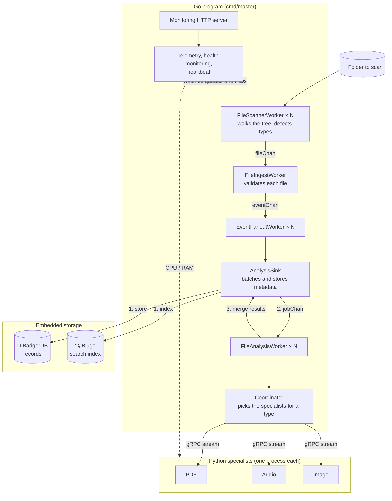

# Architecture

One Go program runs the whole pipeline. The Python specialists are separate processes that it starts and talks to over gRPC.

## The stages

| Stage | Role |
| :--- | :--- |
| `FileScannerWorker` | Reads directories from a shared queue and pushes the subdirectories back into it. Skips symbolic links, keeps regular files of a supported type. |
| `FileIngestWorker` | Validates what the scanner found and turns it into an event. |
| `EventFanoutWorker` | Routes file events to the analysis sink and copies every event to telemetry. |
| `AnalysisSink` | Stores the file metadata in batches, then queues each file for analysis. Later merges the specialist results into the stored record. |
| `FileAnalysisWorker` | Takes one file at a time, has the specialists analyze it, and hands the results to the sink. |
| `Coordinator` | Starts the specialists, and for a given file calls every specialist that handles its type. |

## Design rules

- **Bounded channels, no loop.** Every queue has a fixed size and data only flows forward, so a slow stage slows down the ones before it and nothing can deadlock on a cycle.
- **Metadata first.** A file is queued for analysis only once its record is stored: the specialist results are merged into that record.
- **Supervised workers.** A worker that panics is restarted by the supervisor; a failure on one file never stops a worker.
- **Stop by context.** Every worker stops when the context is canceled, and the program waits for them before closing the databases.
