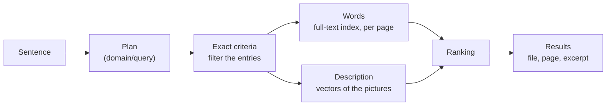

# The catalog: what a search runs on

`infrastructure/catalog` is the notebook of the library: one entry per file, written once when the file is indexed, so that a question is answered without opening any file again. It executes the plans produced by `domain/query` (see [QUERY.md](QUERY.md)).



## What an entry holds

| Known about a file | Used for |
| :--- | :--- |
| Kind, dates, source, size, duration, page count | Filters |
| Country and city | Place: files taken elsewhere are dropped, files without location are kept after the others |
| Text of each page, text read in a picture, transcript | Words, with the page and an excerpt |
| Contents of QR codes and barcodes | `QR code` filter |
| Number of faces, portrait, signature | Ranking only |
| Vectors (one per picture, one per sampled frame of a video) | What the file shows |

The date a search compares with is the date the file was taken when the file says so, otherwise the date it joined the library.

## Filters and rankings

A criterion that relies on exact metadata filters. A criterion that a model judged only ranks: a relevant file that was judged badly still appears, lower.

- **Words** are searched in French: stop words, stems, no accents (`électricité`, `electricite` and `Électricités` meet). A file holding every word asked for comes before one holding some. Each word may be found under the variants of the lexicon (`CGV` finds `Conditions Générales de Vente`).
- **A description** is compared with the vectors. A picture is a match when it is close to the best one and above a floor; the others are still listed after, marked `beyond` and not counted, so that nothing is silently cut.
- **What is not wanted** removes a file when it can be told: the file shows the excluded thing more than the wanted one.
- **When nothing matches**, the plan is loosened one filter at a time (source, then period) and the answer says which. The kind of file is never dropped.

## Trying it

```bash
go run ./cmd/query -library infrastructure/catalog/testdata/library.json -now 2026-11-14
```

```
> Trouve-moi le PDF avec la signature de mon fournisseur d'électricité, à la fin.
Recherche : PDF · signature · texte : signature, électricité · à la fin
  4 résultats
  1. contrat-fourniture.pdf — page 3 — « Fait à Paris en deux exemplaires. Signature du client. Signature pour EDF. »
```

`testdata/library.json` describes 40 files such as a phone may hold.

## What is real and what stands in

| Part | State |
| :--- | :--- |
| Filters, words, pages, excerpts, ranking, loosening, storage on disk | Real, tested |
| Vectors of pictures | **Stand-in.** Here a picture is described by a caption, and `WordEncoder` turns words into vectors. No vision model has run on a single picture yet. |
| `VisualMargin`, `VisualFloor` | Placeholders: they depend on the vision model and must be calibrated with it |
| Filling the catalog from real files | Not written: the existing pipeline still stores into the older store |
| Place names | The entry must hold the country and the city in French; turning GPS coordinates into names is not written |

## Speed

On a library of the size expected (5 000 photos, 300 videos of 12 frames, 300 documents of 15 pages, vectors of 768 numbers), on a desktop CPU, one run:

| Search | Time |
| :--- | :--- |
| A description, compared with 8 600 vectors | 14 ms |
| Words in 4 500 pages | 18 ms |
| Words and a period | 28 ms |
| Filters only | under 2 ms |

Encoding the description with a real model is not included, and nothing is measured on a phone.
