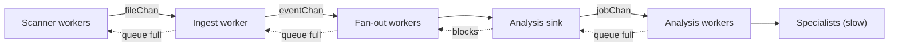

# Performance and backpressure

Scanning is fast: listing a directory and reading the first bytes of a file takes microseconds. Analysis is slow: transcribing an audio file can take minutes. The pipeline is built so that the fast part cannot flood the slow one.

## How the pressure travels back

1. The specialists are busy, so the analysis workers stop taking jobs.
2. `jobChan` fills up. The sink blocks when it tries to queue the next file.
3. The fan-out workers are blocked in the sink, so `eventChan` fills up.
4. The ingest worker blocks, so `fileChan` fills up.
5. The scanner workers block on `fileChan` (and pause earlier, see below).

Nothing is dropped and memory stays bounded: at most a few queues of `BUFFER_SIZE` entries plus one batch per fan-out worker.

## Settings that matter

| Setting | Effect |
| :--- | :--- |
| `BUFFER_SIZE` | Size of every queue between two stages. |
| `SCANNER_WORKER_NB` | Directories explored in parallel. Helps on SSDs and network drives, little on spinning disks. |
| `ANALYSIS_WORKER_NB` | Files analyzed at the same time. Each one is loaded in memory, up to `MAX_FILE_SIZE_MB`. |
| `NUMBER_OF_WORKERS` | Fan-out workers. |
| `MAX_ANALYZED_EVENT`, `BUFFER_TIMEOUT` | The sink writes a batch when it holds this many files, or after this delay. |
| `SCANNER_BACKPRESSURE_LOW_THRESHOLD_PERCENT`, `..._HARD_...` | Above these fill levels of `fileChan`, a scanner worker pauses 20 ms or 200 ms before its next directory. |

## The scanner's directory queue

Scanner workers both read directories from a queue and push the subdirectories they find back into it. If a worker waited for room in a full queue, all of them could wait at the same time and the scan would hang. So when the queue is full, a worker explores the subdirectory itself instead of waiting.

## Observing it

`ChannelCapacityWorker` samples the fill level of every queue each `METRIC_INTERVAL`, and a warning is logged when a queue is nearly full (`LOW_CAPACITY_THRESHOLD`). The same data feeds the monitoring pages.
