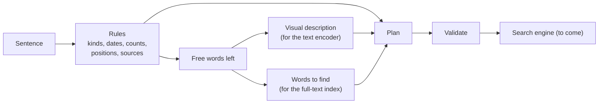

# From a sentence to a search plan

The `domain/query` package translates a free French sentence into a `Plan`: what kind of file, from when, showing what, containing which words. It uses rules only. It needs no model, no network and no phone, and it answers in microseconds.

The plan is not executed against the index yet: this package is the first step, the one that can be written and tested on its own.



## What is read by rules

| In the sentence | Example | In the plan |
| :--- | :--- | :--- |
| Kind of file | `PDF`, `photos`, `vidéo`, `capture d'écran`, `mémo vocal` | `kinds` |
| Period | `il y a un mois`, `ces 6 derniers mois`, `l'an dernier`, `en mars`, `samedi dernier`, `avant 2023` | `date` |
| Codes | `QR code`, `code-barres` | `features` |
| People | `5 personnes`, `un homme avec une femme`, `un couple`, `portrait` | `people`, `features` |
| Size, duration | `PDF assez volumineux`, `petite vidéo`, `de plus de 50 pages` | `size`, `duration` |
| Place in the document | `à la fin`, `en première page`, `page 12` | `position` |
| Where the file comes from | `téléchargé`, `reçu par WhatsApp` | `source` |
| Order, number | `le plus récent`, `les trois dernières` | `sort`, `limit` |
| Words visible in a picture | `une image du mot herbe`, `où il y a écrit ...` | `text` with scope `written` |

The clock is a parameter, so dates are tested with a fixed day. A rough period is widened on purpose: `il y a un mois` covers 20 to 45 days back.

## What is left to the search engine

The words no rule took are the meaning of the sentence. Where they go depends on what is searched:

| Searched | The free words become |
| :--- | :--- |
| Photos, videos | a visual description, and weak words that may match a file name |
| PDF, audio | words to find in the text |
| No kind given | both |
| Words visible in a picture | words to find in the recognized text only |

A lexicon maps what people say to what documents print: `mon fournisseur d'électricité` searches `électricité`, `edf`, `engie`... It is personal and can be extended from a JSON file (`-lexicon` in the command).

## Filters and rankings

Only the kind of file, the period, the source and the presence of a code filter the results, because they rely on exact metadata. Everything else ranks them: a relevant file that a model judged badly must still appear, lower in the list.

When a search returns nothing, `Relax` loosens one filter at a time (the source, then the period) and says which one. The kind of file is never dropped.

## A conversation is a plan that changes

`Session` keeps the current plan. Each sentence either starts a new search or adjusts the current one:

| Said | Effect |
| :--- | :--- |
| `pas celle de l'an dernier` | excludes a period |
| `montre seulement les PDF` | replaces the kinds |
| `et en vidéo ?` | same subject, other kind |
| `avec un chien`, `plutôt un salon` | adds to the subject, replaces it |
| `plus récent`, `avant ça` | changes the order |
| `le deuxième`, `la suite`, `nouvelle recherche` | selects a result, asks for more, starts over |

## Checking a plan

Every criterion records the words it comes from (`origin`). `Validate` refuses a plan holding a criterion that no word of the user accounts for. The rules always pass; the check is there for plans written by a language model (`ParseJSON`), which can add a filter nobody asked for.

`Plan.Chips` words the plan for the user (`PDF · depuis le 26 avril 2026 · texte : notice, lave-vaisselle`), so that a misunderstanding is seen and fixed before scrolling through wrong results.

## Measuring it

`testdata/` holds three sets of sentences with the plan expected for each. The first one contains the sentences the rules were written for. The two others were written afterwards, run once, and only then used to improve the rules: on wordings never seen, the parser fully understood 13 sentences out of 25, then 11 out of 20, with the kind of file right every time. All three now pass and guard against regressions.

A new measure needs new sentences: add them to a new file before changing any rule.

### Measuring a language model

`TestBenchmark` scores any source of plans against the owner's reference set (`testdata/phrases_cible.json`). Each line of its input is a sentence with the plan a model wrote for it, or the rules' own plan as a baseline:

```bash
QUERY_BENCH=run.jsonl go test ./domain/query/ -run TestBenchmark -v
```

A plan that invents a criterion is refused by `ParseJSON` and counted apart. Criteria the plan format cannot hold yet (place, page count, exclusions) are counted apart too, so a score is never flattered by what cannot be read.

Baseline on the reference set, rules only: **15 of 37 fully right (41 %)**, not tuned on this set.

## Limits

- French only.
- A sentence that names two different searches is read as one, except for `..., et tous les autres`.
- Counting people relies on faces found when a picture is indexed; the parser only records the number asked for.
- `signature` is recorded as a feature, but nothing detects a signature yet.
