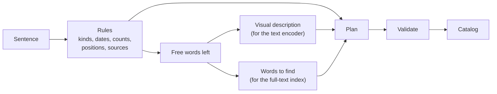

# From a sentence to a search plan

The `domain/query` package translates a free French sentence into a `Plan`: what kind of file, from when, showing what, containing which words. It uses rules only. It needs no model, no network and no phone, and it answers in microseconds.

A plan is executed by the catalog: see [CATALOG.md](CATALOG.md).



## What is read by rules

| In the sentence | Example | In the plan |
| :--- | :--- | :--- |
| Kind of file | `PDF`, `photos`, `vidéo`, `capture d'écran`, `mémo vocal` | `kinds` |
| Period | `il y a un mois`, `ces 6 derniers mois`, `l'an dernier`, `en mars`, `samedi dernier`, `avant 2023` | `date` |
| Codes | `QR code`, `code-barres` | `features` |
| People | `5 personnes`, `un homme avec une femme`, `un couple`, `portrait` | `people`, `features` |
| Size, duration | `PDF assez volumineux`, `petite vidéo`, `de plus de 50 pages` | `size`, `duration` |
| Place in the document | `à la fin`, `en première page`, `page 12` | `position` |
| Where the file comes from | `téléchargé`, `reçu par WhatsApp` | `source` |
| Order, number | `le plus récent`, `les trois dernières` | `sort`, `limit` |
| Words visible in a picture | `une image du mot herbe`, `où il y a écrit ...` | `text` with scope `written` |
| Exact day | `le 18 juin 2026`, `le 3 mars`, `du 1er au 15 mai` | `date` |
| Place | `au Mexique`, `à Lisbonne`, `en France` | `place` |
| Numeric limits | `de plus de 5 minutes`, `de moins de 2 pages` | `seconds`, `pages` |
| What is not wanted | `pas celles de la plage`, `sauf les selfies`, `sauf les vidéos` | `visual.not`, `kinds` |
| Language of the text | `en anglais` | `language` |

The clock is a parameter, so dates are tested with a fixed day. A rough period is widened on purpose: `il y a un mois` covers 20 to 45 days back.

## What is left to the search engine

The words no rule took are the meaning of the sentence. Where they go depends on what is searched:

| Searched | The free words become |
| :--- | :--- |
| Photos, videos | a visual description, and weak words that may match a file name |
| PDF, audio | words to find in the text |
| No kind given | both |
| Words visible in a picture | words to find in the recognized text only |

A lexicon maps what people say to what documents print: `mon fournisseur d'électricité` searches `électricité`, `edf`, `engie`... It is personal and can be extended from a JSON file (`-lexicon` in the command).

## Filters and rankings

Only the kind of file, the period, the source and the presence of a code filter the results, because they rely on exact metadata. Everything else ranks them: a relevant file that a model judged badly must still appear, lower in the list.

When a search returns nothing, `Relax` loosens one filter at a time (the source, then the period) and says which one. The kind of file is never dropped.

## A conversation is a plan that changes

`Session` keeps the current plan. Each sentence either starts a new search or adjusts the current one:

| Said | Effect |
| :--- | :--- |
| `pas celle de l'an dernier` | excludes a period |
| `montre seulement les PDF` | replaces the kinds |
| `et en vidéo ?` | same subject, other kind |
| `avec un chien`, `plutôt un salon` | adds to the subject, replaces it |
| `plus récent`, `avant ça` | changes the order |
| `le deuxième`, `la suite`, `nouvelle recherche` | selects a result, asks for more, starts over |

## Checking a plan

Every criterion records the words it comes from (`origin`). `Validate` refuses a plan holding a criterion that no word of the user accounts for. The rules always pass; the check is there for plans written by a language model (`ParseJSON`), which can add a filter nobody asked for.

`Plan.Chips` words the plan for the user (`PDF · depuis le 26 avril 2026 · texte : notice, lave-vaisselle`), so that a misunderstanding is seen and fixed before scrolling through wrong results.

## Where a language model fits

Rules cannot know every way of talking. In "il me faut absolument le PDF de mon bail", nothing tells a rule that "absolument" is not something to search. That is the one question given to a small language model, through the `NoiseJudge` interface: among the words the rules left over, which are conversation?

The model can only remove words from the description. It cannot add a filter, move a date or choose a kind of file, so whatever it answers it cannot invent a criterion. `ParseWith` keeps the plan of the rules whenever the judge fails, is slow, says nothing, or would leave nothing to search, and does not ask about a lone word.

Asking a model to write the whole plan was tried first and does not work at this size: see the measures below.

## Measuring it

`testdata/` holds five sets of sentences with the plan expected for each.

| Set | Sentences | Role |
| :--- | :--- | :--- |
| `phrases.json` | 48 | The sentences the rules were first written for |
| `phrases_holdout.json` | 25 | Written after the rules; first run 13/25 |
| `phrases_unseen.json` | 20 | Written after; first run 11/20 |
| `phrases_cible.json` | 37 | The owner's own sentences; the rules were then extended for them (places, exact days, bounds, exclusions) |
| `phrases_libres.json` | 40 | Free, conversational wordings; first run 26/40 |

Every set was used to improve the rules after its first run, so all of them now guard against regressions and none is an independent measure any more. **A new measure needs new sentences, run once before any rule is changed.**

### Measures with a model

Run on a 4-core CPU with llama.cpp, Qwen3 models quantized to 8 bits. Each figure is one run.

Writing the whole plan (`scripts/query_model_bench.py`), on the 37 sentences of the owner, before the rules were extended for them:

| Source | Fully right | Refused by the check | Mean time |
| :--- | :--- | :--- | :--- |
| Rules | 15 / 37 | 0 | 50 µs |
| Qwen3 0.6B | 0 / 37 | 36 | 6.6 s |
| Qwen3 1.7B | 4 / 37 | 19 | 8.0 s |

The models invent features (a QR code becomes a "signature"), miscompute dates and leave search words empty.

Judging noise only (`scripts/query_noise_bench.py`), on the 40 free sentences, first run:

| Source | Fully right | Mean time |
| :--- | :--- | :--- |
| Rules | 26 / 40 (65 %) | 50 µs |
| Rules + Qwen3 1.7B as judge | 31 / 40 (78 %) | 0.76 s |
| Rules + Qwen3 0.6B as judge | 30 / 40 (75 %) | 0.47 s |

The 1.7B model removed only conversation words in that run. The 0.6B model also named real subjects ("chien", "plage", "feu d'artifice"): its score holds only because the guard refuses to drop every word, so it is not fit for the role.

These are small samples on a desktop CPU. Speed, memory and heat on the phone are not measured.

To measure a source of plans against a set:

```bash
go build -o /tmp/query ./cmd/query
python scripts/query_noise_bench.py MODEL.gguf domain/query/testdata/phrases_libres.json run.jsonl /tmp/query
QUERY_BENCH=run.jsonl QUERY_BENCH_SET=testdata/phrases_libres.json go test ./domain/query/ -run TestBenchmark -v
```

## Limits

- French only.
- One place per sentence: in `les photos de Tokyo et de Kyoto`, the second city is read as a description.
- A place without a capital letter is only recognized if it is a known country or large city, or was added with `WithPlaces`.
- A place ranks results and never excludes a file: a picture without location is kept, after the located ones. Matching a name to GPS coordinates is the job of the index, not written yet.
- A date means the date the file joined the library, or the date it was taken when the file carries one. The plan does not distinguish them.
- A sentence that names two different searches is read as one, except for `..., et tous les autres`.
- Counting people relies on faces found when a picture is indexed; the parser only records the number asked for.
- `signature` is recorded as a feature, but nothing detects a signature yet.
